<p align="center"></p>

# MoviQ — Where Movies Bring People Together

MoviQ is an AI-powered social movie platform. You can keep a personal film vault, rate and review movies, add friends, run movie communities (CineCircles) with real-time group chat, vote on what to watch, plan movie nights, and get recommendations from six AI services that work from your actual viewing data.

MoviQ (formerly **CineVault**) builds on the original CineVault 1.0 movie review app. Every 1.0 feature still works on the same routes and API: catalog browsing, search, movie details, ratings, reviews, the watchlist, profiles and the admin dashboard.

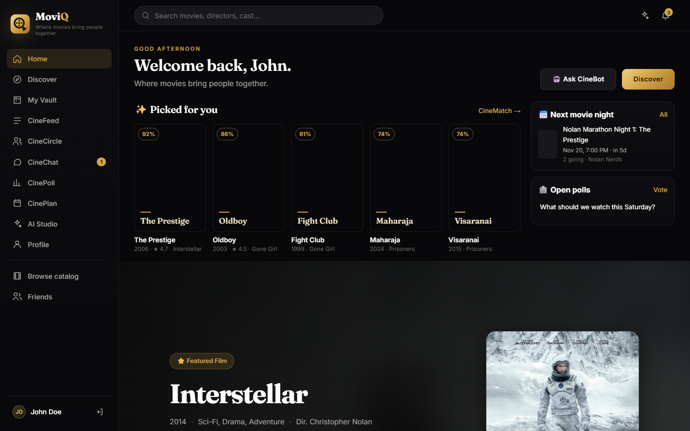

**Logo:** a "Q" drawn as a film reel with a play-button tail ([docs/moviq-logo.svg](docs/moviq-logo.svg)). The same artwork is used for the favicon (`public/favicon.svg`, `favicon.ico`, `apple-touch-icon.png`) and the in-app `<mq-logo>` component.

---

## Contents
1. [Features](#features)
2. [Architecture](#architecture)
3. [Technology stack](#technology-stack)
4. [Installation](#installation)
5. [Environment variables](#environment-variables)
6. [Demo accounts](#demo-accounts)
7. [API documentation](#api-documentation)
8. [Database structure](#database-structure)
9. [AI implementation](#ai-implementation)
10. [Security & privacy](#security--privacy)
11. [Testing](#testing)
12. [Screenshots](#screenshots)

---

## Features

### Movies & My Vault (kept from 1.0, now upgraded)
- Search the catalog by title, director, cast or synopsis, with genre, **language**, year and rating filters.
- **Curated catalog:** 16 all-time top IMDb films (12 Angry Men, Schindler's List, Seven Samurai, The Return of the King…) and 18 acclaimed **Tamil** films (Nayakan, Thalapathi, Baasha, Anbe Sivam, Visaranai, Vada Chennai, Jai Bhim, Vikram, Ponniyin Selvan: I, Maharaja…), shown in their own **All-time greats** and **Tamil cinema** rows on Discover.
- **TMDB integration** (optional): search, trending, browse by genre, and one-click import of any TMDB movie into the catalog, including poster, backdrop, cast, characters, keywords and trailer.
- **Vault statuses**: *Want to Watch*, *Watching* and *Watched*, plus favourites.
- **Collections**: themed lists that can be public, friends-only or private, and can be shared to the feed.
- Ratings and reviews: one review per user per movie, with editing, deletion, live average ratings and admin moderation.
- "More like this" suggestions on every movie page, based on content similarity.

### Social
- **Friends**: user search, friend requests (send, accept, reject, cancel), unfriending, follows, online/offline presence and taste-match scores.
- **Profiles**: avatar upload, a public profile page with stats, plus the user's library, reviews and collections, each shown according to that user's privacy settings.
- **CineCircle**: public or private communities with a cover image, roles (owner, admin, member) and friend invites. Each circle has its own feed, group chat, polls, events, shared watchlist, members list, Group CineMatch and CinePulse.
- **CineChat**: real-time messaging over Socket.IO:
  - one-to-one chats (between friends only) and circle group chats
  - replies, emoji reactions, typing indicators and online status
  - movie cards, recommendation cards and review cards inside messages (share any movie or your own review from its page with *Send to chat* / *Share*)
  - spoiler-protected messages and unread counters
  - every message is saved to the database
- **CinePoll**: movie polls with poster options. Polls can be single- or multiple-choice and can have an expiry time; results update live. The database prevents duplicate votes. Closing a poll (by hand or when it expires) picks the winner and notifies the circle. Group CineMatch can suggest poll options.
- **CinePlan**: movie nights with a date, venue, address, booking link and description. Features:
  - an event can be created from a closed poll; the poll's winning movie is pre-selected and the two stay linked
  - selective invites and RSVP (*Going* / *Maybe* / *Not going*)
  - alternative-date proposals where members mark their availability
  - automatic reminders 24 hours and 1 hour before
  - post-event feedback ratings, which feed CinePulse
- **CineFeed**: posts, recommendations, reviews, watch updates, collections, polls and events, with likes and comments. Tabs: *For you*, *Friends*, *Circles*, *Popular* and *My posts*.
- **CineDiscover**: trending movies, what friends are watching, popular reviews, most-discussed movies, popular polls, people with similar taste, popular circles and personal recommendations.
- **Notifications**: saved to the database and pushed live for friend requests, invites, polls, events, reminders, likes and comments.

### Six AI features (in **AI Studio** and throughout the app)

| Feature | What it does | Where it shows up |
|---|---|---|
| **CineMatch** | Hybrid recommender (content-based + item collaborative filtering + quality prior) with a reason for each pick. **Group CineMatch** balances every member's taste fairly. | Home, Discover, AI Studio, CineCircle, poll creation, CineBot |
| **CineSense** | Builds a personal Movie DNA: archetype, personality text, favourite genres, directors, actors and decades, storytelling styles, rating habits and monthly viewing. Can be regenerated. | AI Studio |
| **Review Intelligence** | Writing help: grammar fixes, readability, summary, sentiment and rating-consistency check, themes, craft analysis (acting, cinematography, screenplay, direction, music), spoiler check, caption, and five rewrite styles. **It only suggests; nothing changes until the user applies it.** | Movie page review form, AI Studio |
| **CineSpoiler** | Spoiler detection sentence by sentence. Spoilers are hidden behind click-to-reveal; content about a movie you've already watched is never hidden from you; there is a per-user on/off setting. | Reviews, chat, posts, comments, AI Studio |
| **CineBot** | Movie assistant. It looks up real movie data (retrieval-augmented) before answering, shows movie cards you can add to your vault, suggests follow-up questions, and is spoiler-free by default. | AI Studio, top bar |
| **CinePulse** | Group analytics: genre preference trends, voting statistics, participation, consensus, best-received movie nights, and a suggested next genre with an honest confidence level. | CineCircle, AI Studio |

---

## Architecture

```
Angular 22 SPA (standalone components, lazy routes)
   │  REST (JWT)                         │  Socket.IO (JWT handshake)
   ▼                                     ▼
Express API ──────────────── realtime/socket.js (rooms: user:, conv:, circle:)
   │
   ├── routes/            auth · movies · reviews · watchlist · users (1.0)
   │                      social · collections · circles · chat · polls · events · feed
   │                      discover · notifications · tmdb · ai (2.0)
   ├── services/          tmdb (cache + import) · chat · polls · notify
   ├── jobs/scheduler.js  poll expiry, event reminders (every 30 s)
   ├── ai/                ← modular AI services
   │     text.js          tokeniser, TF-IDF, cosine, sentiment, readability
   │     cinematch.js     hybrid + group recommender
   │     cinesense.js     Movie DNA
   │     reviewIntel.js   review assistant
   │     cinespoiler.js   spoiler classifier
   │     cinebot.js       retrieval assistant (LLM tool-use or local intent router)
   │     cinepulse.js     group analytics
   │     llm.js           optional Claude provider (server-side key only)
   ▼
MongoDB (Mongoose) ── user data, social graph, chat, polls, events, AI records
TMDB API (optional) ── movie metadata, posters, trending
```

The AI services are plain Node modules behind `/api/ai/*`, so they share the database, the authentication and the access checks with the rest of the app. Each one has a **local implementation that runs with no API key**. A Claude API key adds LLM capabilities on top (see [AI implementation](#ai-implementation)).

### Project structure (new and changed parts)
```
backend/
  ai/                 six AI services + NLP toolkit + LLM wrapper
  jobs/scheduler.js   background jobs
  models/             User*, Movie*, Review*, Watchlist* (*extended) + Friendship, Follow, Collection,
                      Circle, CircleMember, Conversation, Message, Poll, PollVote, MovieEvent,
                      Post, Comment, Notification, AIRecords
  realtime/socket.js  Socket.IO server
  routes/             1.0 routes + 11 new route modules
  services/           tmdb, chat, polls, notify
  utils/              http helpers (validation, regex escaping), access control
  seed-social.js      demo community
  test/               api.smoke.mjs (1.0), v2.smoke.mjs (2.0)
frontend/movie-review-frontend/src/
  app/components/     chat window, poll card, post card, review assistant, group match, pulse, modals
  app/shared/         avatar, poster tile, spoiler text, movie picker, icons, column chart, pipes
  app/pages/          1.0 pages + onboarding, discover, vault, feed, circles, circle-detail, chat,
                      polls, events, event-detail, ai-studio, people, user-profile
  app/services/       api, realtime, toast + extended auth & watchlist services
  styles/v2.css       design system (dark + cinematic gold)
```

---

## Technology stack

| Layer | Technology |
|---|---|
| Frontend | Angular 22 (standalone components, control flow, lazy routes), TypeScript, RxJS, `socket.io-client`, plain CSS design tokens (Fraunces + Inter) |
| Backend | Node.js 18+, Express 4, Socket.IO 4, Mongoose 8, JWT, bcrypt, helmet, express-rate-limit |
| Database | MongoDB. If no MongoDB server is reachable locally, the backend starts and manages a persistent local `mongod` for you. |
| AI | Local NLP and ML in JavaScript (TF-IDF, cosine similarity, item-based collaborative filtering, lexicon sentiment, a logistic-style classifier, Dirichlet smoothing). Optional Claude via `@anthropic-ai/sdk` |
| External data | TMDB API v3 (optional) |

---

## Installation

Prerequisites: **Node.js 18+**. MongoDB is optional; see the database row above.

```bash
# 1. Backend
cd backend
npm install
cp .env.example .env          # then edit JWT_SECRET (and optionally TMDB / Anthropic keys)
npm run seed                  # catalog + demo community (wipes existing data!)
# or, to keep existing data and only add the IMDb top + Tamil titles:
npm run movies:add            # idempotent: skips titles already present
npm run dev                   # http://localhost:5000  (or: npm start)

# 2. Frontend (second terminal)
cd frontend/movie-review-frontend
npm install
npm start                     # http://localhost:4200
```

The frontend calls `http://localhost:5000/api` by default. To use a different backend, set `window.MOVIQ_API` before the app boots (see `src/app/config.ts`).

---

## Environment variables

All settings live in `backend/.env`; `backend/.env.example` documents every one. Keys are only ever read on the server and are never sent to the browser.

| Variable | Required | Purpose |
|---|---|---|
| `MONGO_URI` | yes | MongoDB connection string |
| `JWT_SECRET` | yes | Secret used to sign login tokens. Use a long random value. |
| `PORT` | no | API port (default 5000) |
| `CLIENT_URL` / `CORS_ORIGINS` | no | Frontend origin(s) allowed for CORS and Socket.IO |
| `TMDB_READ_TOKEN` *or* `TMDB_API_KEY` | no | Enables TMDB search, trending, genre browsing and import. Get one at [themoviedb.org → Settings → API](https://developer.themoviedb.org/docs/getting-started). |
| `ANTHROPIC_API_KEY` | no | Turns on the LLM features (CineBot LLM mode, review rewrites, LLM spoiler verification, richer Movie DNA text) |
| `ANTHROPIC_MODEL` | no | Defaults to `claude-opus-5-5` |
| `AI_PROVIDER=local` | no | Use only the local models, even if a key is set |
| `CINESPOILER_LLM=off` | no | Turn off LLM verification of borderline spoiler sentences |
| `AUTH_RATE_LIMIT`, `AI_RATE_LIMIT`, `WRITE_RATE_LIMIT` | no | Rate-limit tuning |
| `SCHEDULER_INTERVAL_MS` | no | How often the poll-expiry and reminder job runs |
| `UPLOAD_DIR` | no | Where uploaded images are stored (default `backend/uploads`, git-ignored) |

For tests, `TMDB_BASE_URL` and `ANTHROPIC_BASE_URL` can point the backend at mock servers (see `test/integration.mock.mjs`).

**Without TMDB:** search covers the local catalog, Trending is calculated from activity on MoviQ, and the UI explains that TMDB isn't configured.
**Without an Anthropic key:** every AI feature still works with its local model. Only review *style rewrites* need the LLM, and that endpoint returns a clear `503` with setup instructions.

---

## Demo accounts

After `npm run seed`:

| Role | Email | Password |
|---|---|---|
| Administrator | `admin@moviereview.com` | `admin123` |
| User (main demo) | `john@example.com` | `password123` |
| Community members | `priya@`, `marcus@`, `lena@`, `sam@example.com` | `password123` |

The seed is made of ordinary database records: 62 movies (including the IMDb top and Tamil cinema additions), ratings that give collaborative filtering real overlap, friendships, a pending friend request, two circles (the private *Weekend Movie Club* and the public *Nolan Nerds*), chat history (including an auto-hidden spoiler), a closed poll linked to a past movie night with feedback, an open poll, an upcoming event and feed posts.

> Movies without poster artwork (the 2.0 seed additions, plus The Godfather and The Matrix, whose original links no longer work) show a generated typographic poster instead. Importing them from TMDB brings in the real posters.

---

## API documentation

Base URL: `http://localhost:5000/api`. 🔒 means a `Authorization: Bearer <token>` header is required.

### 1.0 endpoints (unchanged)
| Method | Path | Notes |
|---|---|---|
| POST | `/auth/register`, `/auth/login` | Return the user and a JWT (now including preferences and privacy settings) |
| GET/PUT | `/auth/profile` 🔒 | |
| GET | `/movies` | `search, genre, year, minRating, sort, page, limit` (search input is regex-escaped) · 2.0 adds `language` (ISO 639-1, e.g. `ta`) and `keyword` (e.g. `imdb top`) |
| GET | `/movies/genres/list`, `/movies/:id` | |
| POST/PUT/DELETE | `/movies[/:id]` 🔒 admin | |
| GET/POST | `/movies/:id/reviews` | POST 🔒. Accepts `containsSpoilers` (optional; otherwise CineSpoiler decides) |
| PUT/DELETE | `/reviews/:id` 🔒 | Author only (admins can delete) |
| GET | `/reviews/my` 🔒, `/reviews` 🔒 admin | |
| GET/POST/DELETE | `/watchlist`, `/watchlist/:movieId`, `/watchlist/check/:movieId` 🔒 | |
| * | `/users/*` 🔒 admin | User management and dashboard stats |

### 2.0 endpoints
| Area | Endpoints |
|---|---|
| Preferences | `PUT /auth/preferences` 🔒: favourite genres, directors, actors and movies; bio; avatar; `privacy`; `onboarded` |
| Vault | `PUT /watchlist/:movieId` 🔒 `{status, favorite}` · `GET /watchlist?status=` · `POST /watchlist/:movieId {status}` |
| Movies | `POST /movies/import/:tmdbId` 🔒 · `GET /movies/:id/similar` |
| TMDB | `GET /tmdb/status`, `/tmdb/search?q=`, `/tmdb/trending`, `/tmdb/genre/:genre`, `/tmdb/movie/:tmdbId` |
| Collections 🔒 | `GET/POST /collections` · `GET/PUT/DELETE /collections/:id` · `POST/DELETE /collections/:id/movies/:movieId` |
| People 🔒 | `GET /social/users/search?q=` · `GET /social/users/:id[/library|/reviews|/collections]` |
| Friends 🔒 | `GET /social/friends` · `GET /social/friends/requests` · `POST /social/friends/:userId` · `POST /social/friends/requests/:id/accept|reject` · `DELETE /social/friends/:userId` · `POST/DELETE /social/follow/:userId` |
| Circles | `GET /circles/discover` · 🔒 `GET/POST /circles` · `GET/PUT/DELETE /circles/:id` · `POST /circles/:id/join|decline|leave|invite` · `GET /circles/:id/members` · `PUT/DELETE /circles/:id/members/:userId` · `POST/DELETE /circles/:id/watchlist/:movieId` |
| Chat 🔒 | `GET /chat/conversations` · `GET /chat/unread` · `POST /chat/direct/:userId` · `GET/POST /chat/conversations/:id/messages` (`text, kind, movieId, reviewId, replyTo, isSpoiler`) · `POST /chat/messages/:id/react` · `POST /chat/conversations/:id/read` |
| Polls 🔒 | `GET /polls?circle=&status=` · `POST /polls` · `GET/DELETE /polls/:id` · `POST/DELETE /polls/:id/vote` · `POST /polls/:id/close` |
| Events 🔒 | `GET /events?circle=&when=upcoming|past` · `POST /events` (`pollId` converts a poll) · `GET/PUT/DELETE /events/:id` · `POST /events/:id/rsvp` · `POST /events/:id/proposals` · `POST /events/:id/proposals/:pid/availability|adopt` · `POST /events/:id/feedback` |
| Feed 🔒 | `GET /feed?tab=&circle=&before=` · `POST /feed` · `DELETE /feed/:id` · `POST /feed/:id/like` · `GET/POST /feed/:id/comments` · `DELETE /feed/:postId/comments/:id` |
| Discover | `GET /discover/trending` · 🔒 `GET /discover` |
| Uploads 🔒 | `POST /uploads/image` (multipart field `image`; JPEG/PNG/WebP/GIF, max 2 MB) → `{ url }` · files served from `/uploads/<random>.<ext>` |
| Notifications 🔒 | `GET /notifications` · `POST /notifications/:id/read` · `POST /notifications/read-all` |
| AI 🔒 | `GET /ai/status` · `GET /ai/cinematch?genre=&seed=` · `GET /ai/cinematch/circle/:id?members=` · `GET /ai/cinesense` · `POST /ai/cinesense/regenerate` · `POST /ai/review/analyze` · `POST /ai/review/rewrite` · `POST /ai/review/history/:id/accept` · `GET /ai/review/history` · `POST /ai/spoiler/detect` · `POST /ai/bot/chat` · `GET /ai/pulse/:circleId` |

### Socket.IO events
- Client → server: `conversation:join`, `conversation:leave`, `typing {conversationId, typing}`, `circle:join`, `circle:leave`. Every room join is checked against the database.
- Server → client: `message:new`, `message:reaction`, `conversation:read`, `typing`, `presence`, `notification`, `poll:update`, `event:update`, `circle:watchlist`.

---

## Database structure

| Collection | Purpose / key fields | Indexes |
|---|---|---|
| `users` | Profile, `role`, bio, avatar, **user preferences** (favourite genres, directors, actors, movies), `privacy` {profile and library visibility, AI consent, spoiler shield}, `lastSeen` | unique `email` |
| `movies` | 1.0 fields + `tmdbId`, `originalLanguage` (not `language`: MongoDB text indexes reserve that name), `keywords`, `characters`, `tmdbRating`, `popularity` | unique sparse `tmdbId`, text, genre |
| `watchlists` | Per-user movie entries (**user_movies**): `status`, `watchedAt`, `favorite` | unique (user, movie), (user, status) |
| `reviews` | Rating and comment + `containsSpoilers`, `spoilerSentences`, `spoilerMarkedBy`, `sentiment` | unique (movie, user) |
| `collections` | Owner, name, movies, visibility | |
| `friendships` | Requester, recipient, `pending`/`accepted` | unique pair |
| `follows` | Follower → following | unique pair |
| `circles` | Name, cover, visibility, owner, `sharedWatchlist`, `conversation` | |
| `circlemembers` | Circle, user, role, `active`/`invited` | unique (circle, user) |
| `conversations` | `direct`/`circle`, participants, `directKey`, per-user read markers | unique sparse `directKey` |
| `messages` | Sender, kind, text, movie, review, `replyTo`, reactions, `isSpoiler` | (conversation, createdAt) |
| `polls` | Question, embedded **poll_options**, multiple choice, expiry, status, winner, linked event | (circle, createdAt), (status, expiresAt) |
| `pollvotes` | **poll_votes**: one document per (poll, user, option) | **unique (poll, user, option)** |
| `movieevents` | **movie_events** with embedded **event_attendees** (RSVP), date proposals with availability, feedback, reminder flags | (circle, startsAt), (attendee, startsAt) |
| `posts` | **social_posts**: kind, visibility, embedded **likes**, counters, spoiler flag | (author, date), (circle, date) |
| `comments` | Post comments with spoiler flag | (post, date) |
| `notifications` | User, actor, type, title, link, read | (user, read, date) |
| `movie_recommendations` | Saved CineMatch runs (personal and group) | |
| `movie_dna_profiles` | CineSense profiles (one per user) | unique user |
| `ai_review_history` | Review Intelligence requests and whether the user applied them | |
| `spoiler_detections` | CineSpoiler classification log | |
| `group_analytics` | CinePulse snapshots | |

Deleting a user also deletes their friendships, follows, memberships, posts and notifications. Deleting a circle removes its members, chat and posts.

---

## AI implementation

Hard rule: **nothing is faked.** Every result is computed from database records or TMDB data. When a capability needs an LLM that isn't configured, the API says so instead of making up an answer.

### CineMatch (`ai/cinematch.js`)
- **Item features:** genre one-hots, director, top 5 cast, TMDB keywords, release decade and the TF-IDF of the synopsis, combined into an L2-normalised sparse vector.
- **User taste vector:** each movie the user interacted with contributes with a weight. Ratings are centred on 3★ (with a bonus for 4–5★); watched, watching and want-to-watch carry implicit weights; favourites count extra; onboarding genres, directors and actors are added as explicit features. This last part handles the **cold-start** case.
- **Collaborative filtering:** item-based, using adjusted cosine similarity over co-raters, with shrinkage `n/(n+3)` and at least 2 co-raters. Users who opted out of history use are left out of the rating matrix.
- **Hybrid score:** `w_c·content + w_cf·CF + w_q·quality`. The weights adapt to how much data exists (CF only gets weight when there is support), and quality is a Bayesian-average blend of community and TMDB ratings.
- **Explanations:** the strongest overlapping features ("Matches your taste for Sci-Fi", "Directed by …"), the nearest movie the user liked ("Because you rated Memento 5★") and the CF signal.
- **Group CineMatch:** each member's scores are min-max normalised, then combined as `0.45·mean + 0.35·min (least misery) + 0.2·(1 − 2σ)` (a disagreement penalty), so one enthusiast can't outvote everyone else. Movies more than half the group has seen are excluded. The output includes group compatibility (the average pairwise cosine between members' tastes), a score for each member, the genres the group agrees on, and a "broad appeal" flag.

### CineSense (`ai/cinesense.js`)
Aggregates affinity-weighted statistics over the user's movies: genres (with average rating per genre), directors, actors, decades, rating distribution and a 12-month viewing series. Storytelling styles are found by matching a lexicon against synopses, keywords and (if the user allows it) their review text. The archetype is the best-scoring of six rule-based profiles. The personality paragraph is written from those numbers, with a confidence label. With an LLM, only the **aggregated statistics** are sent, never raw reviews, to get a richer narrative.

### Review Intelligence (`ai/reviewIntel.js`)
Runs locally: rule-based grammar and spelling fixes (each with a reason), Flesch readability, an extractive TextRank-style summary, lexicon sentiment with negation and intensifier handling, a rating-consistency check, theme detection, aspect-based sentiment for acting, cinematography, screenplay, direction and music (with quoted evidence), and the CineSpoiler check. The summary and caption are built from the corrected text and **leave out spoiler sentences**. Style rewrites (casual, professional, critical, cinematic, short) use the LLM with structured output and a prompt that forbids changing the reviewer's opinion or adding facts. Every request is logged, and `accepted` is only set when the user clicks *Apply*.

### CineSpoiler (`ai/cinespoiler.js`)
A logistic-style classifier that scores each sentence on:
- revelation phrases ("turns out", "in the end", "reveals that", …) and plot-outcome verbs, which push towards *spoiler*
- the movie's own character and cast names, but only when they appear **together with** an outcome
- opinion language and "no spoilers" disclaimers, which push towards *not a spoiler*

Merely mentioning a movie or a character doesn't trigger it. With an LLM, borderline sentences (probability 0.3–0.7) get a second opinion, and only those sentences are sent. The verdict is applied automatically to reviews, chat messages, posts and comments unless the author explicitly chooses. The UI hides flagged sentences behind click-to-reveal, never hides content about movies the viewer has watched, and respects each user's spoiler-shield setting.

### CineBot (`ai/cinebot.js`)
- **With an LLM:** Claude runs a tool-use loop over `search_catalog`, `search_tmdb`, `get_movie_details`, `recommend_for_me`, `get_my_history` (returns nothing if the user hasn't given permission) and `recommend_for_circle` (membership-checked). The system prompt requires every factual claim to come from tool results and keeps answers spoiler-free unless the user turns that off. Movie cards are built from the tool results that the answer actually mentions.
- **Without an LLM:** a local intent router (movies like X, director or actor, mood, twists, underrated, circle, personal recommendations, explain the ending) answers from the same retrieval functions. "Explain the ending" returns the facts it can retrieve and says that a full interpretation needs the LLM.

### CinePulse (`ai/cinepulse.js`)
Genre preference is estimated with a **Dirichlet-smoothed multinomial** (α = 0.5). The evidence comes from votes (split across each voted movie's genres), poll winners, movie-night feedback and members' own ratings of the movies the group watched together (centred on 3★), plus current member tastes. It also reports voting statistics, participation, consensus (the winner's vote share), the best-received movie nights and genre trends by month. The confidence level depends on how many observations there are, and the wording of insights is softened to match ("shown an early lean towards…"). The recommendation always carries a caveat that it isn't guaranteed.

### LLM provider (`ai/llm.js`)
Uses the official `@anthropic-ai/sdk`, defaulting to `claude-opus-5-5`, with structured JSON output where it's needed and server-side refusal fallbacks enabled. The key is read only from the server environment. If a call fails, the service falls back to its local model where that makes sense.

---

## Security & privacy
- bcrypt password hashing (12 rounds) and JWT authentication on every protected route and on the Socket.IO handshake.
- `helmet` security headers, a 200 kB JSON body limit, and rate limits on login/register, AI and social endpoints.
- **Secure file handling:** uploads require authentication, are limited to 2 MB and one file, have their type verified from magic bytes (the client's filename and MIME type are ignored), are stored under random server-chosen names (no path traversal or overwrites), and are served with `nosniff` and a `default-src 'none'` CSP.
- Input validation: ObjectId checks, length limits, http(s)-only URLs for avatars, covers and booking links, and regex-escaped search input (prevents ReDoS and regex injection).
- Authorisation is checked on the server for everything. Private circles, their chats, polls and events are visible only to members. Direct messages can only start between friends, and only participants can read a conversation. Library, review and profile visibility settings are enforced in the API.
- **AI consent:** *Use my viewing history* (CineMatch, CineSense, CineBot and the collaborative-filtering matrix) and *Use my review text* can be switched off in Profile → Privacy & AI data. Only aggregated statistics or individual sentences are ever sent to an LLM, never personal identifiers.
- No secrets are in the repository. `.env` is git-ignored and `.env.example` documents every variable.

---

## Testing

With the backend running and the database seeded:

```bash
cd backend
npm test            # runs all three suites (needs MongoDB on 127.0.0.1:27017, e.g. while the dev backend runs)
npm run test:api    # 1.0 regression suite (51 checks)
npm run test:v2     # 2.0 end-to-end suite (116 checks) incl. real Socket.IO clients
npm run test:integration  # LLM + TMDB paths against local contract mocks (36 checks)
npm run test:live   # OPTIONAL: real Anthropic/TMDB using your keys in .env (restart the backend first; a few cents)
```

`test/v2.smoke.mjs` covers:
- registration and onboarding; vault statuses and collections
- friend requests (accept/reject), follows and privacy enforcement
- private-circle access control and invites
- real-time messaging (delivery, typing, reactions, unread counts, read markers), DM restrictions and spoiler auto-flagging
- polls (creation, live updates, duplicate-vote prevention, multiple choice, closing, winner, notifications)
- events created from polls (RSVP, date proposals, availability, feedback rules)
- the feed (visibility, likes, comments, circle feed); Discover and trending; notifications
- catalog additions (language and keyword filters, CineBot language requests)
- uploads (auth, type spoofing, size limit, safe naming and headers) and sharing reviews into chat
- all six AI services (ranking, exclusions, genre filter, group compatibility and membership, Movie DNA, review analysis, rewrite-without-key behaviour, sentence-level spoiler detection, CineBot retrieval and CinePulse)

Both suites delete the accounts they create, so repeated runs leave no test users behind.

Latest run: **51/51, 116/116 and 36/36 passed**, plus a browser sweep of every route as user, admin and guest at 1440px and 390px (94 page visits, no errors or overflow). The requirement-by-requirement mapping is in [docs/REQUIREMENTS.md](docs/REQUIREMENTS.md). The frontend production build (`npm run build`) is clean.

---

## Screenshots

| | |
|---|---|
|  Home dashboard | 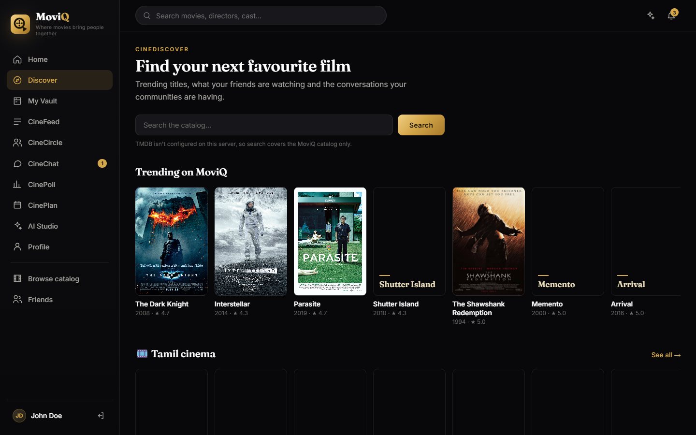 CineDiscover |
| 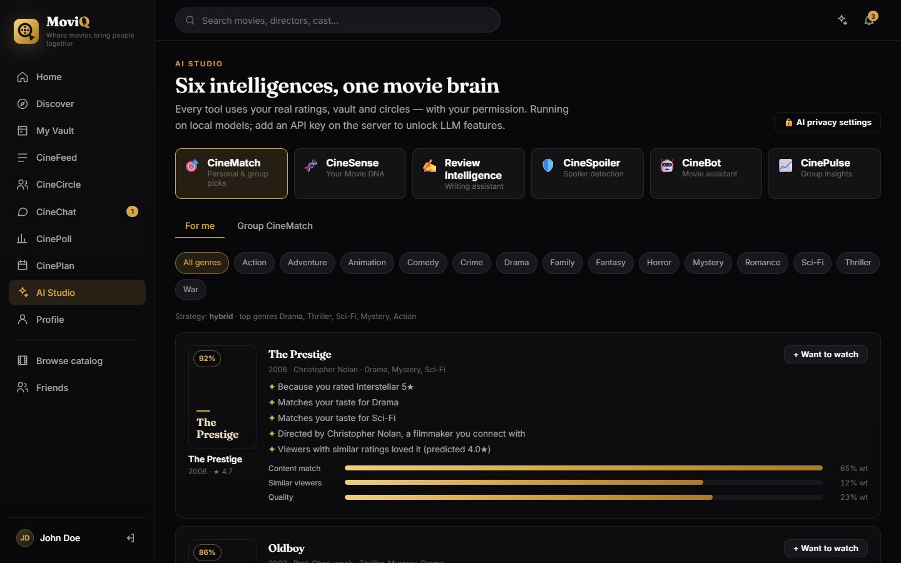 CineMatch | 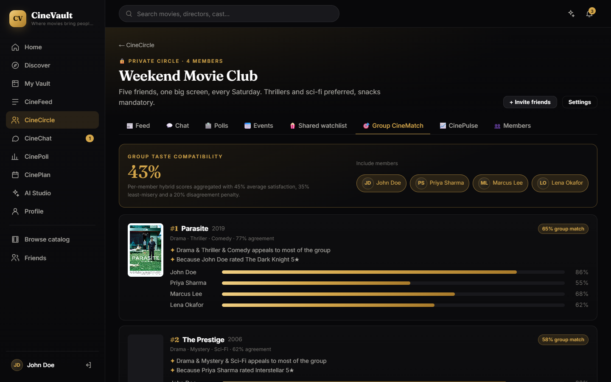 Group CineMatch |
| 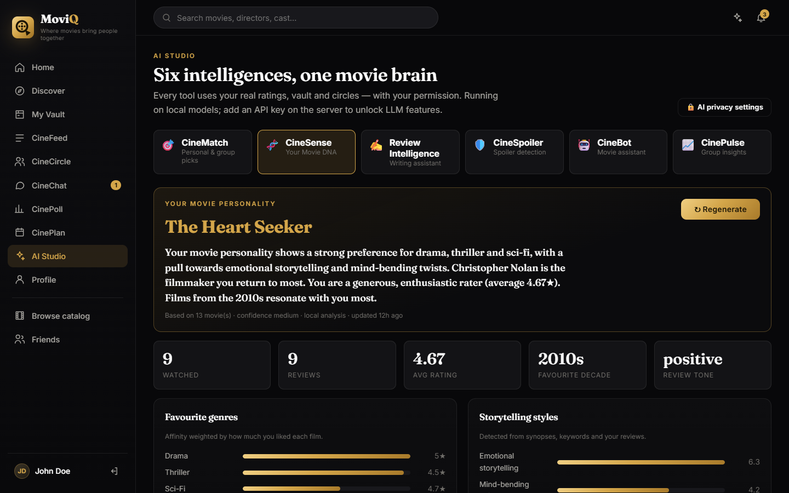 CineSense Movie DNA | 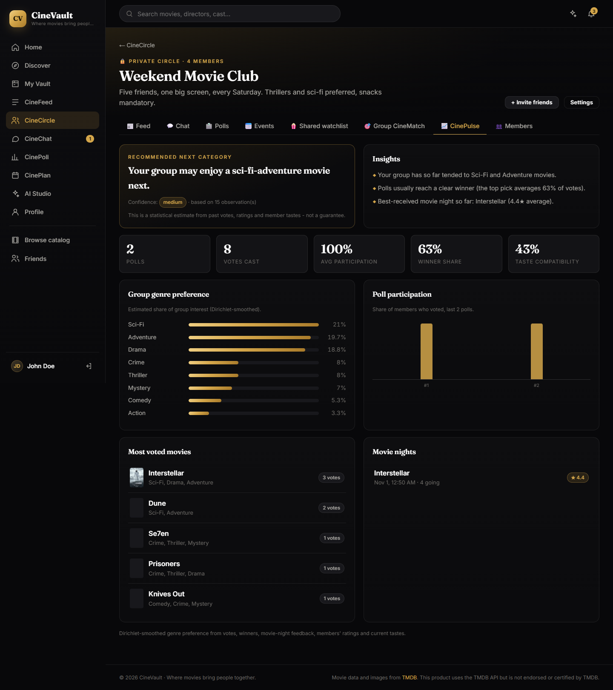 CinePulse |
| 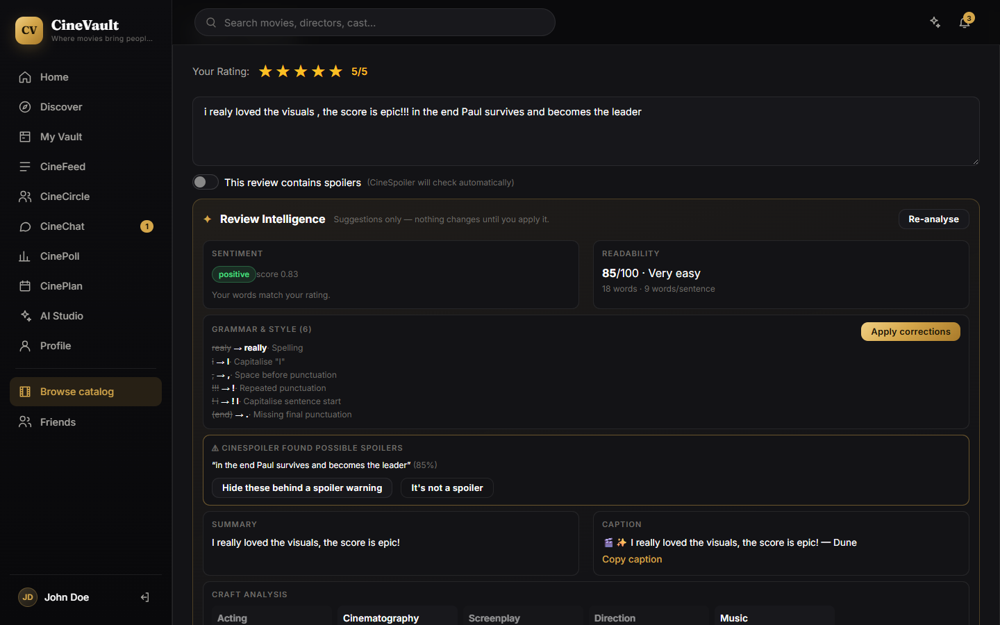 Review Intelligence | 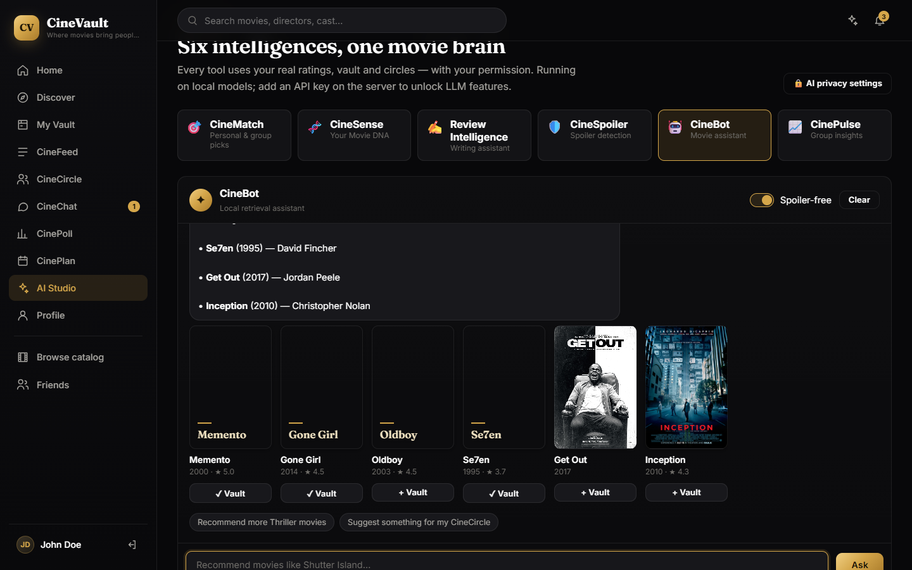 CineBot |
| 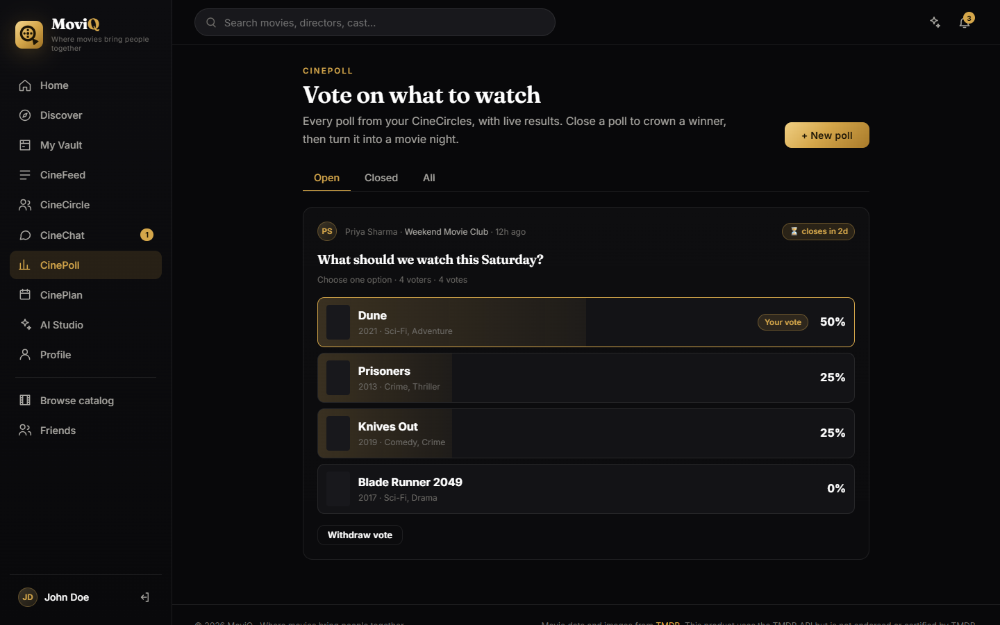 CinePoll | 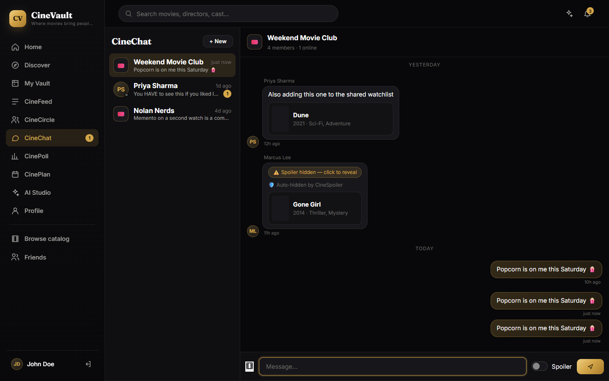 CineChat |
| 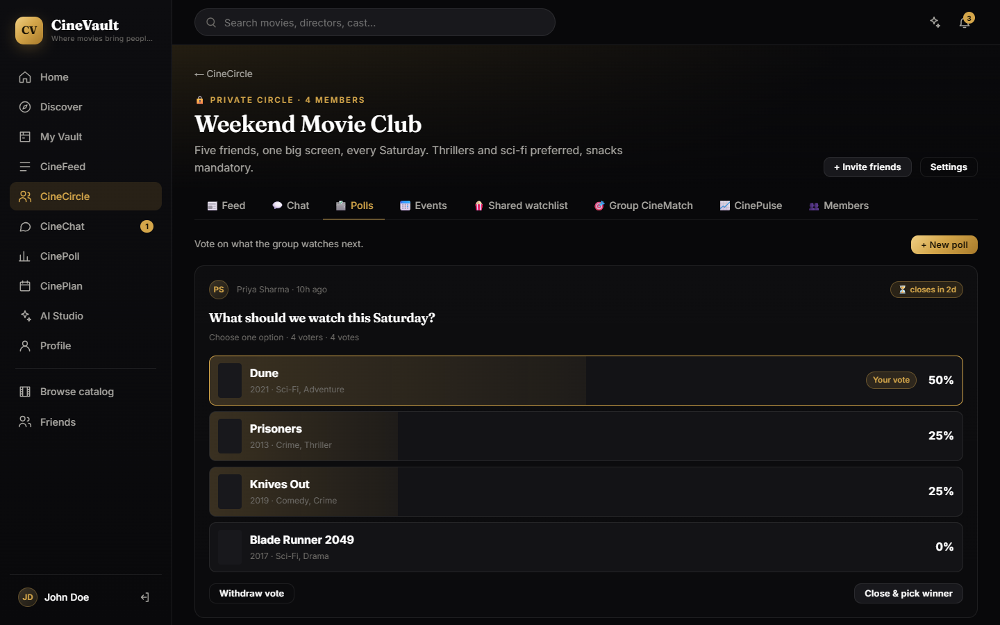 Voting in a circle | 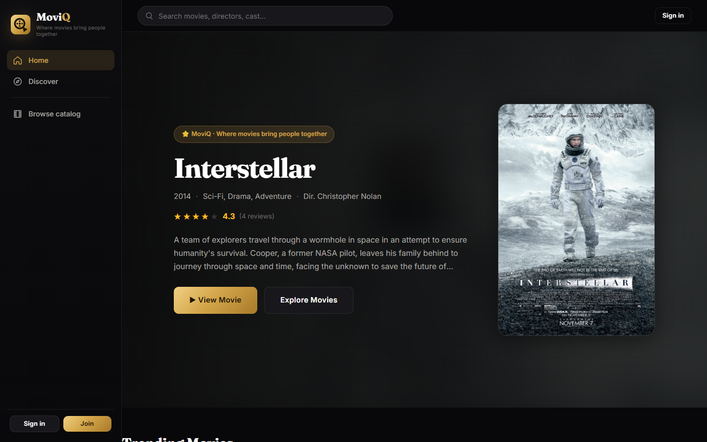 Guest landing page |
